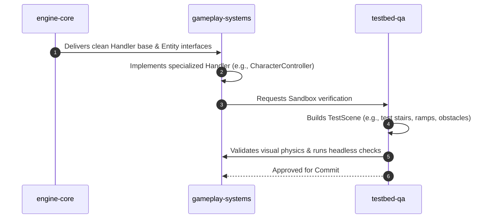

# AI Agent Roles & Collaboration Protocol

To ensure efficient, reliable development without context pollution, the engine development workflow is divided into **three specialized agent roles**.

---

## 1. Role Definitions

### 1.1 `engine-core` (Architecture & Foundation)
* **Scope:**
  * `src/entities/` (`Entity`, entity registry, ID allocation pool).
  * `src/handlers/base.py` (`Handler` interface, lifecycle hooks).
  * `src/scenes/` (`Scene` lifecycle, entity propagation).
  * `src/utils/` (`Event`, signal bus, core math).
* **Responsibilities:**
  * Enforcing composition-over-inheritance patterns.
  * Guaranteeing clean entity lifecycle without memory leaks.
  * Maintaining strictly-typed interfaces and documentation.
  * Ensuring zero headless dependency on graphical window.

### 1.2 `gameplay-systems` (Physics, Controls, Graphics, Camera)
* **Scope:**
  * `src/globals/physics.py` and `src/handlers/physics/` (`CharacterControllerHandler`, `RigidBodyHandler`, `TriggerZoneHandler`).
  * `src/handlers/input/` (`InputHandler`, `WASDInputHandler`).
  * `src/handlers/camera/` (`ThirdPersonCameraHandler`).
  * `src/handlers/graphics/` (`ActorAnimationHandler`, `ModelHandler`).
* **Responsibilities:**
  * Integrating Panda3D's Bullet Physics API (`BulletCharacterControllerNode`, `BulletRigidBodyNode`, `BulletGhostNode`).
  * Implementing responsive, fluid 3D character movement and camera orbit.
  * Managing 3D glTF models (`Actor`) and animation state machines.

### 1.3 `testbed-qa` (In-Engine Sandboxes & Validation)
* **Scope:**
  * `tests/__test.py` (Base testbed scene and sandbox harness).
  * `tests/panda/` (Interactive visual 3D sandboxes for physics, character, animations, camera).
  * `tests/terminal/` (Headless test suites and automated verification scripts).
* **Responsibilities:**
  * Providing isolated, repeatable sandbox environments for every mechanic.
  * Implementing debug telemetry (FPS, velocity vectors, Bullet wireframe overlays).
  * Verifying that all modules pass headless execution before commits.

---

## 2. Collaboration Protocol & Definition of Done

Every new feature or handler must adhere to this delivery cycle:

### Definition of Done (DoD)
A task is only considered complete when:
1. Code strictly follows typed signatures and docstrings in English.
2. An interactive sandbox scene exists in `tests/panda/` demonstrating the feature.
3. Unit tests in `tests/terminal/` pass cleanly in headless mode without exceptions.
4. Git commit is registered with a descriptive message adhering to Conventional Commits.
