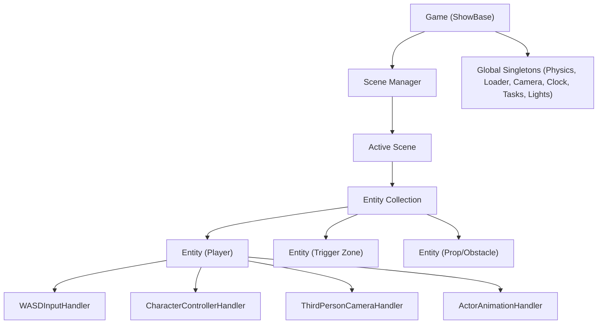

# Engine Architecture Specification

## 1. High-Level Overview

The engine follows a modular, component-based design tailored for 3D real-time applications using Panda3D and Bullet Physics.



---

## 2. Core Subsystems

### 2.1 The Application Root (`Game`)
* Inherits from Panda3D's `ShowBase`.
* Instantiates `Globals` and owns the collection of scenes.
* Supports starting in headless mode (`windowType='none'`) for automated test runners and CI.

### 2.2 Global Singletons (`src/globals/`)
* **`GlobalClock`:** Wraps `ClockObject` to provide frame delta time (`get_dt()`).
* **`GlobalLoader`:** Centralized model/actor caching and path resolution.
* **`Physics`:** Manages the `BulletWorld`, gravity, debug visualization nodes, and rigid/ghost body allocation.
* **`Camera`:** Controls primary viewport positioning, orientation, and target tracking.
* **`GlobalLights`:** Manages default ambient and directional lights with shadow mapping.
* **`Tasks`:** Centralizes Panda3D `taskMgr` job registration and teardown.

### 2.3 Scenes (`src/scenes/`)
* A `Scene` represents an isolated game state (e.g., Level 1, Main Menu, or an isolated Testbed).
* Manages entities created within its scope.
* Lifecycle hooks:
  * `on_start()`: Initializes scene geometry, entities, and lights.
  * `on_update(dt: float)`: Propagates ticks to all active entities and handlers.
  * `on_stop()`: Destroys all scene entities, nodes, tasks, and physics bodies cleanly.

### 2.4 Entities (`src/entities/`)
* An `Entity` is a lightweight object containing:
  * Unique integer `id`.
  * Panda3D `NodePath` (`node`) attached to the scene graph.
  * Dictionary / list of attached `Handler` instances.
  * Instance-level `Event` bus for local messaging.

---

## 3. Communication Patterns

### 3.1 Event System (`src/utils/event.py`)
Handlers and entities communicate through decoupled events:
* **Entity Events:** Local events scoped to a specific entity (e.g., `entity.on_damaged`, `entity.on_collision`).
* **Global Game Events:** Engine-wide signals (e.g., `scene_changed`, `player_spawned`).

### 3.2 Handler Inter-Communication
Handlers query other handlers on the same entity via `entity.get_handler(HandlerClass)`:
```python
# Character movement handler querying input state:
input_handler = self.entity.get_handler(InputHandler)
if input_handler and input_handler.is_action_pressed("jump"):
    self.jump()
```
