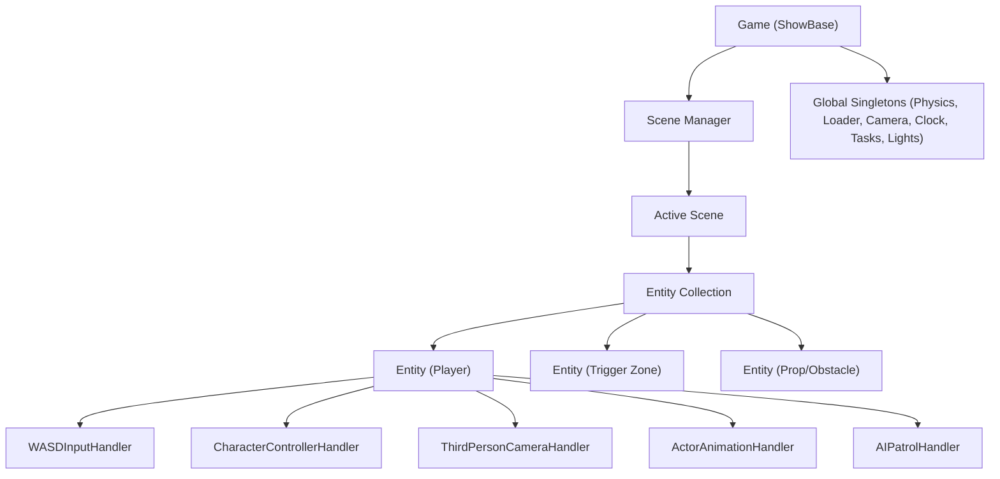

# Engine Architecture

This page is the map of the engine: which layer owns what, and which document holds the detail. Each rule lives in exactly one document; this page links to it.



## Layers

| Layer | Source | What it owns | Detail |
| --- | --- | --- | --- |
| Application root | `src/game.py` | The `ShowBase`, the scene collection, the frame dispatch. | [engine/update_pipeline.md](engine/update_pipeline.md) |
| Globals | `src/globals/` | The Bullet world, the asset cache, the clock, the engine tasks, the lights. | [engine/physics_world.md](engine/physics_world.md), [engine/tasks.md](engine/tasks.md) |
| Scenes | `src/scenes/` | Entities and the tasks that belong to the scene. | [engine/entities_scenes.md](engine/entities_scenes.md) |
| Entities | `src/entities/` | An id, a node, and the handlers attached to them. | [engine/entities_scenes.md](engine/entities_scenes.md) |
| Handlers | `src/handlers/` | One behaviour each, composed onto the entities. | [handlers/README.md](handlers/README.md) |
| Utilities | `src/utils/` | `Event`, `GlobalEventBus`, `Cooldown`, `StateMachine`, math and path helpers. | [utils/README.md](utils/README.md) |

## Ownership

The engine separates **who owns a resource** from **who uses it**, and the split is strict:

- A **scene** owns its entities and its tasks. When the scene stops, it removes its tasks first and frees its entities after, so a task never runs against a half-destroyed entity.
- A **global task** belongs to the engine and outlives the scenes. A task that belongs to a scene must be registered through that scene.
- An **entity** owns its handlers. The order in which they were added is the order in which they run, and that order is part of the contract: a consumer is attached after the producer it reads.
- A **handler** owns the resource it manages: the character controller owns the body it moves, the graphics handler owns the visual instance, the camera handler owns the camera node.

**Rule:** the resource is owned by the object that created it, and the owner is responsible for releasing it. Nothing is released twice.

## Communication

### Events

`Event` (`src/utils/event.py`) is the local message bus. A handler or an entity publishes an event and other parts subscribe to it, without holding a reference to each other. The API is documented in [utils/event.md](utils/event.md).

For engine-wide or cross-entity events without an entity owner (e.g. `level_completed`, `game_paused`), use the `GlobalEventBus` (`src/utils/global_event_bus.py`, exposed as `bus` from `src.utils`). It is complementary to per-entity `Event` instances; see [utils/global_event_bus.md](utils/global_event_bus.md).

### Handler inter-communication

Handlers read each other through the entity, by type:

```python
input_handler = self.entity.get_handler(InputHandler)
if input_handler and input_handler.is_action_pressed(JUMP):
    self.jump()
```

The pattern, the lifecycle and the attach order are documented in [handlers/pattern.md](handlers/pattern.md).

### AI as a virtual input source

The AI handler is an **input source**, not a mover: it writes intent into the entity's `InputHandler` exactly like a human player, and the same movement handler drives both. That is what makes the AI testable headless and keeps a single movement code path. The behaviour is documented in [handlers/ai.md](handlers/ai.md).

## The rules of the engine

| Rule | Owner |
| --- | --- |
| Intent is written in `on_update`, transforms that depend on the simulation in `on_post_update`. | [engine/update_pipeline.md](engine/update_pipeline.md) |
| Tasks are removed by handle, never by name. | [engine/tasks.md](engine/tasks.md) |
| A scene task dies with its scene; a global task does not. | [engine/tasks.md](engine/tasks.md) |
| `entity.node` is not the authoritative position of a character; the controller node is. | [utils/position.md](utils/position.md) |
| The first hit decides a line of sight; a body never hides its owner from itself. | [handlers/ai.md](handlers/ai.md) |
| Camera and sight queries share a single blocker bit, so characters never occlude them. | [engine/physics_world.md](engine/physics_world.md) |
| Handlers use the action constants, never raw key literals. | [handlers/input.md](handlers/input.md) |
| The camera transform is applied to the real lens, not to the transform node. | [handlers/camera.md](handlers/camera.md) |

## Documentation map

- [docs/README.md](README.md) — the map of the documentation itself.
- [engine/README.md](engine/README.md) — the engine subsystems.
- [handlers/README.md](handlers/README.md) — the handler areas.
- [testing/README.md](testing/README.md) — the headless suites and the interactive sandboxes.

Source: `src/game.py`, `src/globals/`, `src/scenes/`, `src/entities/`, `src/handlers/`, `src/utils/`
Tests: `tests/terminal/`
